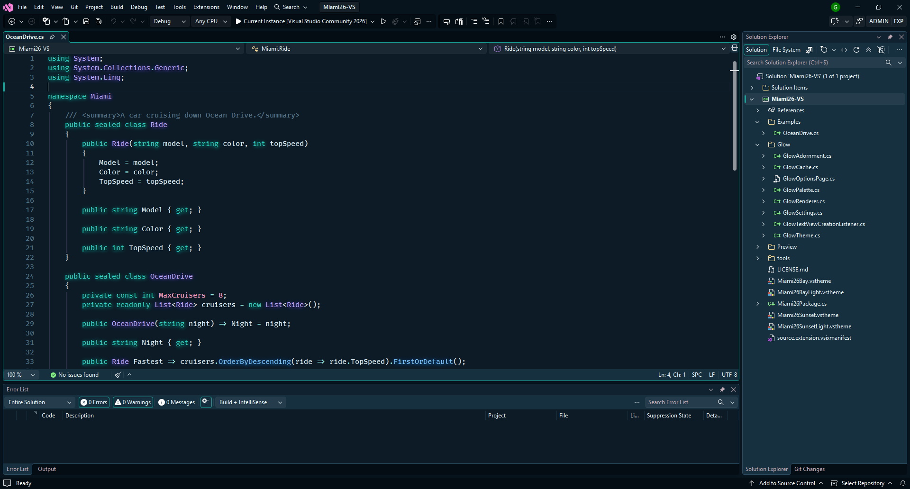
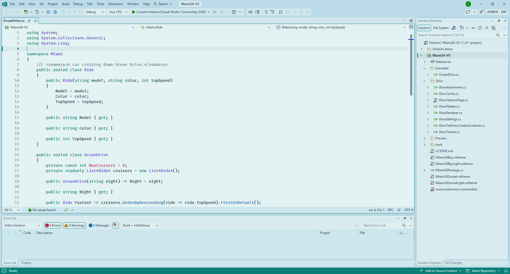
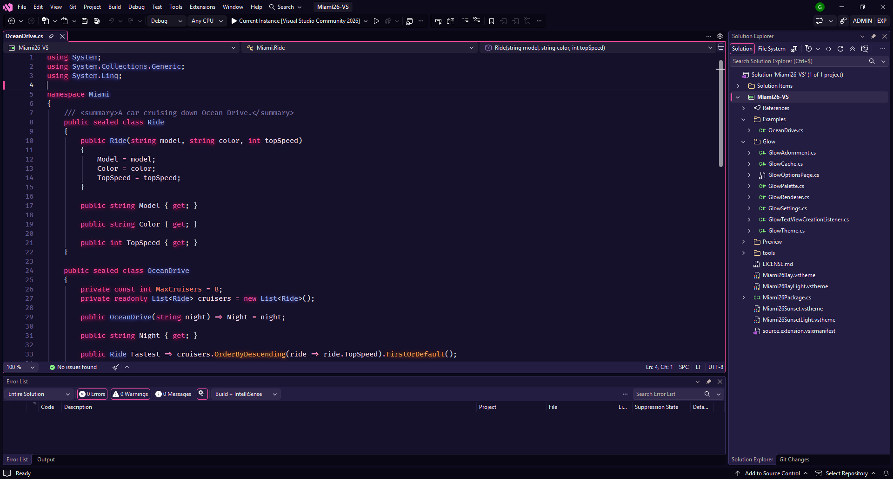
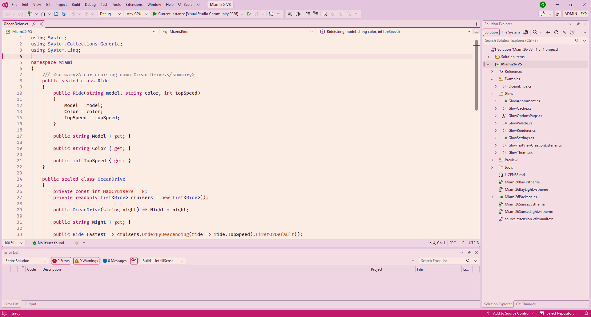

# Miami '26 - Visual Studio theme

[](https://github.com/stillgbx/miami26-vs/actions/workflows/build.yml)
[](https://buymeacoffee.com/stillgbx)

Miami colors for Visual Studio 2019, 2022 and 2026. Two palettes, each in a dark and a light version:

* **Bay**: a day on the bay. Turquoise water, sky blue, lavender towers, pink facades and warm sand.
* **Sunset**: dusk on the ocean front. Magenta, sunset orange, gold and periwinkle buildings under a violet sky.

| | Dark | Light |
| --- | --- | --- |
| Bay | **Miami '26 Bay**, with neon glow | **Miami '26 Bay Light** |
| Sunset | **Miami '26 Sunset**, with neon glow | **Miami '26 Sunset Light** |

### Miami '26 Bay



### Miami '26 Bay Light



### Miami '26 Sunset



### Miami '26 Sunset Light



## Palettes

| Role | Bay | Bay Light | Sunset | Sunset Light |
| --- | --- | --- | --- | --- |
| Frame | `#07131D` | `#BBDBE9` | `#0D0A1C` | `#E3C5DE` |
| Editor | `#0C1B26` | `#E3F2F2` | `#15112A` | `#FBECE4` |
| Status bar | `#13897F` | `#0B7F75` | `#D6337F` | `#C2186A` |
| Keywords | `#2ED3C6` | `#0A7A70` | `#FF4FA3` | `#BD1766` |
| Types | `#B9A6FF` | `#5E45C4` | `#A9B4F5` | `#434BB5` |
| Functions | `#7CC4FF` | `#1C65AD` | `#FFA45C` | `#B5561A` |
| Strings | `#FFC98F` | `#A3561A` | `#FFD27F` | `#845A00` |
| Numbers, constants | `#FF9CC2` | `#BF2F68` | `#FF7A6B` | `#C9392A` |
| Tags, preprocessor | `#7EDC9E` | `#2A7F47` | `#D39BFF` | `#7235AD` |
| Comments | `#557489` | `#5F7F8C` | `#7C6FA3` | `#87718F` |

## Install

### From a release

1. Download `Miami26-VS.vsix` from the [latest release](https://github.com/stillgbx/miami26-vs/releases/latest).
2. Close Visual Studio, then double-click the file.
3. Start Visual Studio and pick the theme in *Tools > Theme*.

Installing a newer release updates the extension in place, no need to uninstall first.

### From source

1. Clone this repository and open `Miami26-VS.sln`.
2. Build in Release, then run `bin\Release\Miami26-VS.vsix`.

Press F5 instead to try your changes in the experimental instance of Visual Studio, without touching your main installation.

## Neon glow

With the dark themes, the extension draws a neon glow around keywords, types, functions, tags and, faintly, variables, each in its own color. It only applies to the text editor, and nothing in the Visual Studio installation is modified.

Turn it on or off and set its brightness in *Tools > Options > Miami '26 > Neon Glow*. The light themes never glow.

## Recommended fonts

* Text Editor: [FiraCode Medium](https://github.com/tonsky/FiraCode 'FiraCode Medium')
* Environment: [Roboto](https://fonts.google.com/specimen/Roboto 'Roboto Medium')

If a color you changed yourself in *Tools > Options > Environment > Fonts and Colors* wins over the theme, click *Use Defaults* there.

## Credits

* The dark themes are built on the environment of [SynthWave '84 for Visual Studio](https://github.com/stillgbx/synthwave-vs), and the neon glow comes from it. SynthWave '84 itself is by [Robb Owen](https://github.com/robb0wen/synthwave-vscode) (MIT License).
* The light themes are built on the Visual Studio Light theme.

Inspired by the colors of Miami. This is a fan-made theme, not affiliated with any game or studio.

## Development

### Editing the themes

Every color lives in `tools/generate-themes.py`. Each palette (`BAY`, `BAY_LIGHT`, `SUNSET`, `SUNSET_LIGHT`) gives:

* `colors`: the IDE colors (backgrounds, accent, status bar, editor selection...). `DARK_ROLES` and `LIGHT_ROLES` tell which color of each base they replace; the other colors of the base follow the palette (greys take its hue, blues its accent).
* `tokens`: the syntax colors.

Then regenerate the four themes and look at them side by side:

```
python tools/generate-themes.py
python tools/preview-themes.py
```

The second script writes `bin/preview.html`, a mock-up of Visual Studio in each theme, with the glow.

The glow colors are in `Glow/GlowPalette.cs`, keyed by the token colors of the dark themes: change both together, `generate-themes.py` checks that they match.

The bases are `tools/base-dark.xml` (SynthWave '84) and `tools/base-light.xml` (Visual Studio Light, extracted by `tools/import-vs-theme.py` from a Visual Studio installation). They are not named `.vstheme` on purpose: every `.vstheme` file of the project is compiled into the extension. The icon is drawn by `python tools/generate-icon.py`.

### Releasing

1. Increase `Version` in `source.extension.vsixmanifest`: Visual Studio only updates an installed extension to a higher version.
2. Push a tag with the same version, for example `v1.1`. The [Build](.github/workflows/build.yml) workflow builds the VSIX and attaches it to a new GitHub release.
